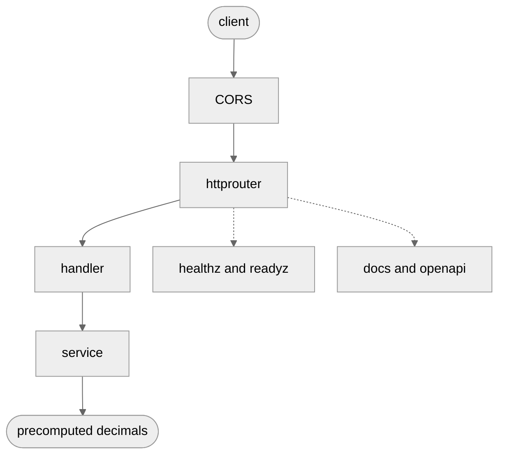

# fibonacci-api

[](LICENSE)

HTTP service that returns the first n Fibonacci numbers.

`n` is a count, not an index: the body is F(0) through F(n-1). `GET /v1/fibonacci?n=5` returns `[0,1,1,2,3]`. Max `n` is 1000. Values are precomputed; F(999) is a 209-digit JSON number.

<div align="center">



</div>

## layout

- `cmd/fibonacci-api` — flags, logger, signals, then `server.Run`
- `internal/server` — listen, timeouts, graceful shutdown, routes
- `internal/handler` — HTTP only: parse query, ETag, status codes
- `internal/service` — parse `n`, table of F(0)..F(999)
- `api` — hand-written `openapi.yaml`, generated types, `/docs`

Math never imports `net/http`. HTTP never recomputes Fibonacci.

## contract

v1 happy path is a raw JSON array. Do not wrap it later. A breaking change is `/v2`, not a quieter v1.

Errors are always `{"code","message"}`:

- `invalid_argument` — empty, negative, leading zeros, `+5`, floats, junk
- `too_large` — above 1000, or a number that does not fit in `int`
- `method_not_allowed` — not GET
- `not_found` — unknown path

Same `n` always yields the same bytes. `ETag` is `"n="+n`. Send that value back as `If-None-Match` to get `304` and no body.

Omit `n` to get `{"min_n":0,"max_n":1000}`.

CORS is `*` (no credentials). Methods: GET, OPTIONS.

The spec in `api/openapi.yaml` is the source of truth. `make generate` refreshes `api/types.gen.go`. Change the YAML first.

## process

`--listen` (default `:8080`) and `--shutdown-timeout` (default 10s). SIGINT/SIGTERM stop the listener, finish in-flight requests, then exit.

`/healthz` and `/readyz` both mean “this process can take HTTP.” They are separate paths so probes can diverge later (for example ready false during drain).

## build

```sh
make binary
./_out/fibonacci-api --listen :8080

make dev   # air: rebuild and restart on save (go install github.com/air-verse/air@v1.67.4)
```

```sh
curl 'http://127.0.0.1:8080/v1/fibonacci?n=5'
# contract: http://127.0.0.1:8080/docs  and  /openapi.yaml
```

## docker

```sh
make docker-image
docker compose up --build
```

## test

```sh
make test              # unit + integration
make test-integration  # live listen on 127.0.0.1:0 (internal/server)
make test-race         # go test -race (what CI runs)
make test-cover        # writes _out/coverage.out
make test-cover-html   # open the profile in a browser
```

Unit tests use `httptest` (`internal/service`, `internal/handler`, `api`). Integration tests start the real `http.Server`, then call it with `net/http`. `make test` and `make test-race` already include both. Use `make test-integration` when you only want the live path.

## lint

```sh
make lint
```

Commit messages follow conventional commits (`feat:`, `fix:`, `chore:`, `ci:`, `test:`, `docs:`, `refactor:`), max 98 characters. GitHub Actions checks them with [commitlint](https://github.com/conventional-changelog/commitlint) (`.commitlintrc.yaml`). In the editor, the Conventional Commits extension can help write them.

CI (`.github/workflows/ci.yml`): lint, commitlint on pull requests, test-race + test-cover, binary. Coverage floor is [go-test-coverage](https://github.com/vladopajic/go-test-coverage) (`.testcoverage.yml`): 80% on `internal/service`, `internal/handler`, and `internal/server`.

## license

This is open source under the [Apache License 2.0](LICENSE).

Use it, change it, ship it. Keep the license with any copy, and you are good. The full legal text lives in [`LICENSE`](LICENSE) at the root of the repo.
